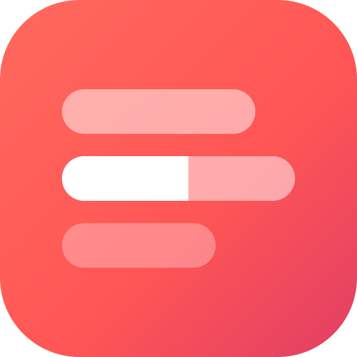
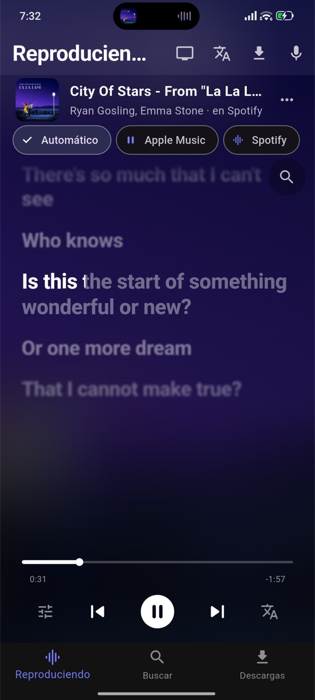
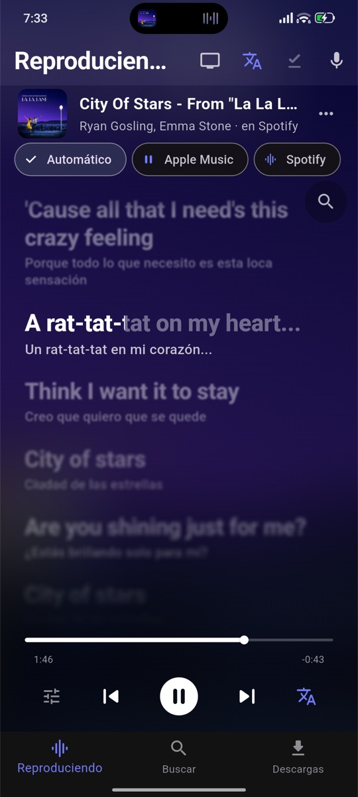
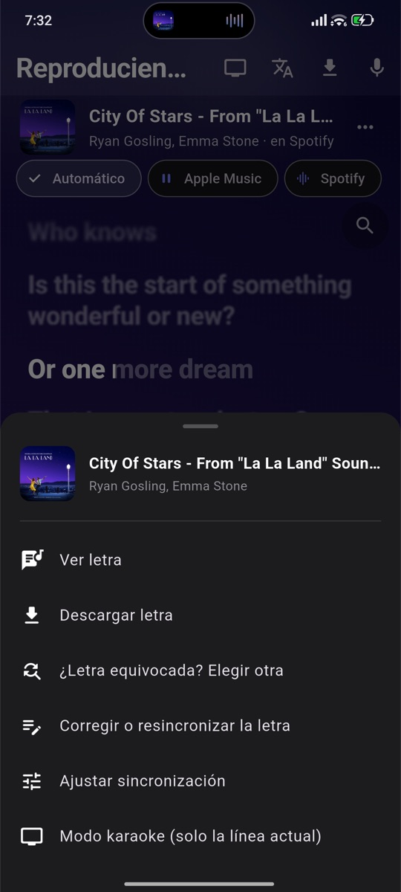
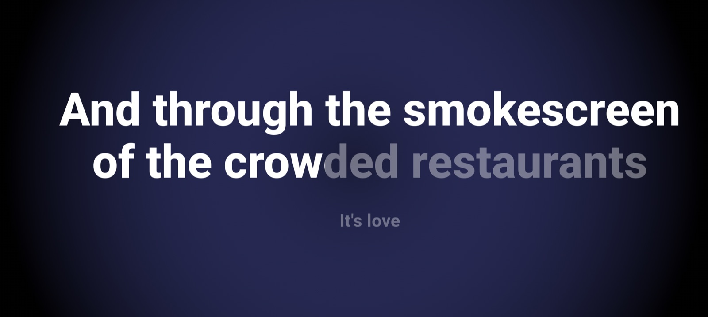

<div align="center">



# Letras

**La letra de lo que estás escuchando, sincronizada y palabra por palabra.**
Estilo Apple Music, para Android y Mac, gratis y sin cuentas.

[](https://github.com/Toinco/letras/releases/latest)

[](https://github.com/Toinco/letras/actions/workflows/ci.yml)


</div>

---

Reproduce música en Spotify, YouTube Music o la app que uses, y **Letras** detecta
sola qué suena y muestra la letra moviéndose al ritmo de la canción. Sin
iniciar sesión, sin anuncios.

<p align="center">
  
  
  
</p>

<p align="center">
  
</p>

## Qué hace

🎤 **Karaoke de verdad** — la línea actual se va llenando palabra por
palabra cuando la letra trae los tiempos de cada palabra, y los coros
(lo que va entre paréntesis) aparecen más chicos y a la derecha.

📺 **Modo karaoke para la tele** — solo la línea actual, enorme, ideal
para duplicar la pantalla en un televisor.

🔔 **Sin abrir la app** — la línea actual en una notificación, en un widget
de la pantalla de inicio o en una burbuja flotante encima de Spotify.

🌍 **Traducción y pronunciación** — traducción línea por línea al idioma
que elijas (opcionalmente con IA, que entiende jerga y dobles sentidos) y
la lectura en letras latinas de canciones en japonés, coreano o ruso.

🎙️ **También por micrófono** — reconoce lo que suena en un altavoz y
puede ir siguiendo canción tras canción.

✍️ **Si la letra está mal, la arreglas** — un editor para corregirla y
sincronizarla tocando en cada línea, y subirla a
[LRCLIB](https://lrclib.net) para que le sirva a todo el mundo.

📥 **Sin conexión** — descarga letras (con traducción y carátula), arma
playlists, busca adentro de las letras, y exporta todo en un ZIP.

📊 **Tus estadísticas** — tus canciones y artistas más escuchados y cuántas
horas de letras viste.

🎨 **Se adapta a cada canción** — el color de la app sale de la carátula
de lo que suena.

## Instalar

### Android

1. Baja el APK de la [última versión](https://github.com/Toinco/letras/releases/latest).
2. Ábrelo en el celular y permite instalar apps de esa fuente.
3. La primera vez, concede **acceso a notificaciones** (así la app puede ver
   qué música suena; no lee tus mensajes).

### Mac

1. Baja `letras-X.Y.Z-macos.zip` de la [última versión](https://github.com/Toinco/letras/releases/latest),
   descomprímelo y arrastra **Letras** a Aplicaciones.
2. La primera vez macOS no la deja abrir porque no está firmada por Apple:
   ve a **Ajustes del Sistema → Privacidad y seguridad** y toca
   **Abrir igualmente** (una sola vez).
3. Pon algo en **Spotify** o en **Música**. macOS pregunta si Letras puede
   controlarlos: acepta, así la app ve qué suena y en qué segundo va.

En la Mac, la letra fuera de la app va en la **barra de menú**, junto al reloj.

Las versiones nuevas se instalan desde la misma app:
**Ajustes → Buscar actualizaciones**.

## De dónde salen las letras

| Fuente | Para qué |
| --- | --- |
| [LRCLIB](https://lrclib.net) | Letras sincronizadas, abiertas y gratuitas (la principal) |
| NetEase Cloud Music | Respaldo, con mucho catálogo asiático y tiempos por palabra |
| Genius | Último recurso, letra sin sincronizar |

La detección de lo que suena usa la sesión multimedia de Android (en la Mac,
le pregunta a Spotify y a Música): no graba audio ni manda nada a ningún
servidor propio. La app no tiene backend.

## Para desarrolladores

Flutter + Kotlin (Swift en la Mac), estado con Riverpod, base local en SQLite, tests con
respuestas HTTP simuladas y CI en GitHub Actions. Cómo compilarla,
probarla y publicar versiones: **[docs/DESARROLLO.md](docs/DESARROLLO.md)**.

```bash
flutter pub get
flutter test
flutter run --dart-define-from-file=config/dart_defines.json
```
